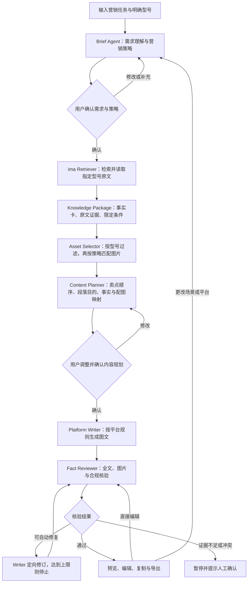

# 华为 PC 门店图文助手：前端对话交接

更新日期：2026-10-18（北京时间）。这是截至交接时的对话总结和实际项目状态，不是比赛成绩或全部功能已完成的声明。

## 0. 给接手对话的直接指令

你主要负责本项目的前端设计与实现。原对话从本次交接起主要负责后端逻辑。请先阅读本文和现有代码，再改前端；不用重复询问已经确认的产品选择。

- 项目目录：`D:\桌面\工作\比赛\浙客松\华为赛道\Huawei-Marketing`。
- 前端工作边界：`frontend/`。可以调整界面布局、视觉、交互和前端状态管理，保留已经确认的业务流程和后端契约。
- 后端归原对话负责：`backend/`。需要新增或变更接口时，把请求/响应建议反馈给用户或原对话，先不要直接改后端。
- 共享文件和依赖跨目录变更需要协调，避免并行修改冲突；不要重建、删除或迁移整个仓库。
- 有些文件尚未提交，但已是真实工作成果；不要把 untracked 当成可清理内容。
- 不要覆盖现有 `架构设计.md` 和 `mermaid-diagram.png`，这两份文件不是原对话本次生成的。
- 用户要求后续开发全部在“华为赛道”目录下，不能因当前聊天 cwd 在“天猫赛道”而将项目移回去。
- 若编辑飞书文档，Codex 新增或改写的文字必须全部紫色，并重新读取确认；本次尚未编辑飞书。

## 1. 对话历史与产品定位

用户参加浙客松华为赛道，最初让助手了解官网提交流程，随后提供题目书。我们完整阅读了 9 页手册并检查关键页面图片。

- 官网：<https://www.tuotuzju.com/hackathon/2/challenges>
- 题目书：`D:\桌面\工作\比赛\浙客松\华为赛道\huawei-challenge-handbook-v4.pdf`
- 赛题：**AI+华为 PC 营销软文智能体**。
- 目标用户：华为门店导购、门店内容运营。
- 产品定位：帮助用户把模糊的营销任务，转成有产品事实依据、配图正确、可修改和可审阅的图文。
- 交付是完整 Agent 应用。Skill 是其中的能力模块，不能只做一个检索或写作 Skill 作为最终作品。
- 不要求自研基础大模型，可以调用公开模型服务。ima 仅提供产品事实和图片；需求理解、策略、规划、写作、核验由自研系统负责。
- 不接受只有概念/PPT/静态页面，或单纯转发 ima 最终文案的作品。
- 用户此前做过 Skill，没有 Agent 开发经验；解释设计时用业务流程和输入输出说明，避免不必要的框架术语。
- 开发方法已讨论：先尽早跑通最小真实链路，再优化各环节，不等每一步“最好”才联调。

## 2. 已确认的第一版范围

- 单次任务围绕一个明确产品型号，产品从指定 ima 知识库动态识别。
- 重点覆盖开学购机、职场移动办公两类场景，允许输入其他任务。
- 发布平台：小红书、公众号、门店朋友圈。
- 完整网页工作台，React 前端 + FastAPI 后端；不是 Streamlit 原型。
- 本机先运行，SQLite 保存任务、中间状态和版本；后续准备魔搭部署。
- 包含任务输入、策略确认、证据查看、图片选择、内容规划、图文预览、正文编辑、核验、修改与导出。
- 第一版不包含注册、团队协作、自动发布、视频生成、复杂产品对比和自建向量数据库。

## 3. 用户通过 grilling 明确确认的选择

这些都是用户已经做出的决定，不必再询问同样的问题。

| 问题 | 用户确认 |
|---|---|
| 自动运行还是先确认 | 先让用户同意需求与策略，再继续；写稿前再次确认规划 |
| 是否直接编辑正文 | 支持，修改后必须重新核验 |
| 工具原型还是产品界面 | 完整产品工作台 |
| 一次确认还是两次 | 两次，分别确认营销方向与具体内容规划 |
| Content Planner 如何编辑 | 段落卡片，能调整卖点顺序、段落目的、事实引用和配图；也能输入修改意见 |
| 是否保存历史 | 保存本机任务和版本，支持恢复中间状态 |
| 模型组合 | `claude-sonnet-5-5` 写作链 + `gpt-6.1-sol` 视觉和独立核验 |
| 需求是否确认可开始 | 用户明确回复“8.是”，之后已开始实现 |
| 模型 API Key 如何填写 | 用户选择稍后在本机设置页填写，尚未提供模型密钥 |

## 4. 完整流程：必须保留 Content Planner 的位置



模块边界：

1. Brief Agent 提取人群、问题、场景、购买阶段、平台、目标，提出可解释策略；没取证前不能断言产品具体能力。
2. Retriever 真实调用 ima，不把搜索摘要当完整原文；空搜索回退目录。
3. Knowledge Package 保存事实及原文证据，保留“约、最高、特定配置、使用条件”等限制。
4. Asset Selector 筛选有来源、型号一致的图片，解释图片适合表达什么，不直接决定全文段落结构。
5. **Content Planner 在图片匹配之后、正式写作之前**，确定卖点顺序、段落目的、每段事实和图片。用户明确强调了这个模块。
6. Writer 按已经确认的规划写稿，不能偷偷增加卖点、换图或扩充无依据事实。
7. Reviewer 输出问题报告，Writer 负责修订；Reviewer 不直接改文章。
8. 资料冲突/证据缺失要停下，人工确认不等于允许无依据内容直接通过。

当前代码自动修订上限为 **1 次**，与之前确认的 MVP 草案一致。已有 `架构设计.md` 中另有“建议最多 2 次”的文字，属于需要后端进一步对齐的差异；前端不要硬编码“最多两次”，也不要自行改变后端循环上限。

## 5. 比赛规则对界面的约束

- 统一四类结果：场景判断、知识库依据、图文软文、核验结果。可以创新布局，但不能把证据和核验藏到用户无法使用的位置。
- 小红书推荐 3–6 张图（至少 1 张，无推荐上限硬拦截）；公众号 2–4 张图；朋友圈 1–3 张图。不能用重复图片凑数。
- 换场景须改变内容切入点、卖点优先级；换平台须改变结构、语气、配图和行动引导。
- 产品事实和图片来自指定 ima 库；无依据价格、补贴、销量、奖项、评价不可生成，不能伪造第一人称体验。
- 图片非 ima 来源或型号错误，图片引用项可能计 0；虚构价格等会使相应任务准确性与合规性计 0。不能用漂亮界面掩盖这些限制。
- 初赛：GitHub、魔搭、作品说明书。复赛增加真实运行视频和至少 3 组结果，覆盖至少 2 类场景、2 个平台。
- 手册未规定本文建议的默认字数是平台官方限制，不要在 UI 中宣称它们是官方硬上限。

之前核对的官网配置：2026-10-18 华为初赛 13:00–17:00；复赛 10-19 00:00 至 10-24 00:00；决赛 10-25。赛程可能更新，正式提交前需刷新官网，而非仅依据本文。

## 6. 服务、凭证与知识库现状

### ima

- 已按用户要求下载并安装官方 Skill 1.1.10：`C:\Users\cheng\.codex\skills\ima-skill`。
- 官方包：<https://app-dl.ima.qq.com/skills/ima-skills-1.1.10.zip>
- 原包 17 个文件逐一校验，Node 脚本语法检查通过。
- 用户已加入“任德耀新建华为PC知识库”，API 已实际验证能访问。
- 凭证配置在 Windows 用户级环境变量：`IMA_OPENAPI_CLIENTID`、`IMA_OPENAPI_APIKEY`。**本交接不包含值，禁止从历史对话复制密钥进代码。**
- 后端在当前进程没继承变量时，可以从 Windows 用户环境读取；前端不读取或保存 ima 凭证。
- 项目 `backend/vendor/ima-skill/` 只复制了调用所需的官方脚本、版本信息和说明，没有凭证。
- 已实际通过项目客户端读到 10 个产品目录项；MateBook 14 鸿蒙版取得 2 份原文、4 张图片，尺寸为 817×892 或 1048×588。
- 实际原文名为 `产品事实.md`、`卖点与限制.md`，不是所有目录都有 `article.md`；图片通过 `图片索引.csv` 与产品目录关联。
- 根目录外还有一个同名包装文件夹，浏览需逐级进入 P1 产品参数库。API 实测库字段为 `kb_id/kb_name`，条目列表为 `knowledge_list`。
- 同级目录 `华为PC知识库.zip` 只做过压缩包目录调查：1,522 文件、112 图片；没有将其解压、提交或作为运行时离线替代。不能声称它和当前 ima 库已完整校验一致。

### 模型网关

用户原始链接把两个地址粘连了，我们已核对公开接入指南：

- 文档：<https://credits.openai-next.com/guide/quickstart>
- 模型列表说明：<https://credits.openai-next.com/guide/resources>
- Base URL：`https://api.openai-next.com/v1`
- 推理：`POST /chat/completions`，`Authorization: Bearer <key>`，JSON `messages`。
- 模型：写作 `claude-sonnet-5-5`；视觉/审核 `gpt-6.1-sol`，在本机设置中可更改。
- **截至交接时，模型 API Key 尚未填写，模型推理未实际执行。** 用户选择稍后在设置页填写。
- 设置页已经存在，密钥 POST/PUT 给本机后端后输入框清空；GET 设置只返回 `has_key`，不回显密钥。
- Windows 下用 DPAPI 加密保存在 `.local/credential.bin`；任务数据在 `.local/tasks.sqlite3`。这些路径都已被 Git 忽略。
- 连接测试目前只调用 `/models`，成功不等于 JSON 或图片推理验证成功。
- 网关公开指南明确了标准文本协议，但没有充分承诺 JSON Schema、json_object 或 image_url 的具体兼容性。当前实现采用“提示词约束 JSON + Pydantic 严格校验 + 有限重试”；图片用兼容消息格式，但还待真实密钥验证。

## 7. 当前代码与职责

```text
Huawei-Marketing/
  backend/
    main.py                  FastAPI 路由、确认门槛、后台任务、导出
    schemas.py               Pydantic 严格数据结构
    clients.py               官方 ima 脚本封装、检索/原文/图片、模型网关
    workflow.py              Brief/事实/选图/Planner/Writer/Reviewer
    storage.py               SQLite 任务、版本、目录缓存
    settings.py              本机设置、用户环境变量、DPAPI
    test_workflow.py          隔离测试，不是真实模型成绩
    requirements.txt
    requirements.lock.txt
    vendor/ima-skill/
  frontend/
    src/
      App.tsx                导航、任务列表、轮询
      StartPage.tsx          任务输入、动态产品选择、平台
      StrategyEvidence.tsx   第一次确认、事实/原文/图片来源
      PlanEditor.tsx         第二次确认、段落排序、事实与图片编辑
      DraftEditor.tsx        成稿编辑、核验报告、导出
      TaskView.tsx           任务工作区、步骤、历史恢复
      SettingsPage.tsx       模型密钥与服务配置
      types.ts               当前前端类型，应对照 OpenAPI
      shared.tsx             API helper 与公共组件
      style.css              当前视觉样式，可重设计
    vite.config.ts
    package.json
    package-lock.json
  docs/
    FRONTEND_HANDOFF.md       本文
    openapi.json             从实际后端导出的接口快照，无密钥
  架构设计.md                已有文件，保留
  mermaid-diagram.png        已有文件，保留
  .local/                    运行资料及 QA 截图，已忽略
  .venv/                     已安装的后端隔离环境，已忽略
```

现有前端是功能初版，不是用户最终批准的视觉稿。可重新设计。保留核心能力，尤其两次确认、可编辑 Planner、原文追溯、编辑后核验失效和当前版本导出约束。

### 本机启动与联调

后端已重新启动在 `http://127.0.0.1:8765`，只监听本机，服务端口也供前端开发代理使用。

```powershell
# 在仓库根目录启动后端（若当前服务已在运行，不要重复占用端口）
.\.venv\Scripts\python.exe -B -m uvicorn backend.main:app --host 127.0.0.1 --port 8765 --no-access-log

# 前端开发
cd frontend
npm run dev

# 前端严格类型检查和生产构建
npm run build
```

- 前端 Vite 默认端口 5173，`/api` 代理到 8765。
- 生产构建位于 `frontend/dist`，由后端 `/` 和 `/assets` 提供；已有构建可在 8765 直接查看。
- 请保持同源 `/api/...` 调用。后端拒绝外部 Origin 的写操作；直接跨端口 fetch 可能被拒绝，使用已有 Vite 代理。
- 后端不启用自动 reload；改 Python 后由后端对话协调重启。前端对话不要随意终止后端进程。
- 目前还没有编写最终 README、一键启动脚本、Docker/魔搭部署文件，也没有实际部署公网。

## 8. 前端必须遵守的 API 契约

以 `docs/openapi.json` 和运行中 `http://127.0.0.1:8765/docs` 为准，以下为导航索引。

| 方法与路径（均带 `/api` 前缀） | 用途/请求体 |
|---|---|
| GET `/health` | 服务存活 |
| GET `/settings` | 非敏感设置、has_key、ima_ready |
| PUT `/settings` | base_url、writer_model、reviewer_model、vision、可选 api_key；留空保留已有密钥 |
| POST `/settings/probe` | 读取模型列表，检查当前配置模型是否可见 |
| GET `/catalog` | 真实产品目录，含产品 id/name/category/path |
| GET `/catalog?refresh=true` | 实际刷新 ima 产品目录 |
| GET `/tasks` | 任务摘要列表 |
| POST `/tasks` | raw、product_id、platform，创建草稿 |
| GET `/tasks/{id}` | 完整任务及后端计算的 can_export |
| POST `/tasks/{id}/analyze` | `{version}`，分析需求，不直接写稿 |
| POST `/tasks/{id}/confirm-brief` | `{version, brief}`，第一次确认后检索/选图/规划 |
| PUT `/tasks/{id}/plan` | `{version, plan}`，保存用户修改的规划 |
| POST `/tasks/{id}/confirm-plan` | `{version, plan}`，第二次确认后写稿并核验 |
| PUT `/tasks/{id}/document` | `{version, document}`，手改稿件；旧报告立即失效 |
| POST `/tasks/{id}/review` | `{version}`，重新检查当前成稿 |
| POST `/tasks/{id}/modify` | `{version, instruction}`，修改任务目标并回到需求确认 |
| GET `/tasks/{id}/history` | 历史版本、说明和时间 |
| POST `/tasks/{id}/restore` | `{version, target_version}`，创建恢复版本，旧核验失效 |
| GET `/assets/{image_id}` | 后端读取过的真实图片；不要直接使用 ima 签名 URL |
| GET `/tasks/{id}/export` | 审核通过后下载 Markdown |
| GET `/tasks/{id}/export?bundle=true` | 审核通过后下载 Markdown+实际配图+核验 JSON 的 ZIP |

平台内部值：`xiaohongshu`、`wechat`、`moments`。

关键对象：

- Brief：audience、scenario、platform、goal、purchase_stage、pain_points、strategy、tone、emphasis、questions。
- Fact：id、claim、quote、source_id、conditions。quote 必须能在对应原文中定位。
- Plan：angle、title_direction、sections、cta。每个 section 有 id、heading、purpose、fact_ids、image_id、image_reason。
- Document：title、lead、paragraphs、cta、tags。每段有 section_id、heading、text、fact_ids、image_id、caption。
- Review：summary、issues、passed、document_hash、checked_at、vision、model。issues 含 category、location、detail、severity、repairable。
- Task：raw、product_id、platform、status、version、brief、package、plan、document、review、events、error、resume_status；GET 时额外带 can_export。

状态包括：`draft`、`analyzing`、`needs_information`、`brief_ready`、`retrieving`、`planning`、`plan_ready`、`writing`、`reviewing`、`approved`、`needs_review`、`error`。

前端注意：

1. 长操作返回 202/accepted，随后轮询 GET task；现有前端约 1.8 秒轮询一次。显示后端真实事件，不伪造已经完成的阶段。
2. 每次写请求带最新 `version`；事件保存也会增加版本，不能假设一次生成只增一版。旧版本会返回 409。
3. 运行中禁止修改该任务；某阶段失败会保留中间状态，`error` 和 `resume_status` 说明原因和重试位置。
4. 不能通过 UI 直接赋值 status/approved/passed，也不能让用户手动勾“核验通过”。
5. 用户编辑正文后，即使只改一个字，也清除旧 review、进入 needs_review。
6. 复制/最终导出以 `can_export` 和当前是否有未保存编辑共同判断；不能只看旧 review.passed。服务端也会校验内容指纹。
7. 未核验、证据冲突或型号/素材不足时，保留问题报告；不要显示绿色“全部通过”。
8. 更改场景/平台会回到 Brief，让用户重新确认。小修改可以直接编辑正文，再检查。
9. 图片替换限于当前产品 package.images；不要加入外部搜图或生成产品图作为替代。
10. UI 显示资料标题和路径、事实/图片说明，不展示完整凭证、ima 内部库/媒体 ID 或签名链接。

## 9. 已验证结果与未验证边界

### 已执行

- 当前后端 **18 项测试通过**：确认门槛、严格类型、过期版本、事实原文匹配、错图/重复图、配图数量、标题新增无依据数值、正文编辑失效、旧内容指纹、恢复历史、跨站写入、DPAPI、自然语言换平台和错误重试等。
- 包含完整流程测试，但该项使用明确的隔离 fixture 模型响应，不是真实模型运行结果，也没有污染用户任务列表。
- 后端真实 ima 集成：产品目录 10 项；一个型号的 2 份原文和 4 张图片读取成功；通过 HTTP 运行的后端也成功刷新目录。
- 最近一次前端 `tsc -b && vite build` 通过。
- 用本机 Chrome 无头浏览器实际检查了首页、产品选项、场景示例填入、无模型密钥时禁止生成、设置页、空任务列表、390px 手机布局。
- 该次浏览器检查无 pageerror、无手机横向溢出。
- QA 截图在 `.local/qa/desktop.png`、`settings.png`、`mobile.png`。
- 之后调整过 CSS 字号与手机断行，**这部分源码尚未重新构建**，旧截图也不能冒充最新样式检查；接手后请先 build 或使用 Vite dev。

### 尚未执行/需要继续

- 没有模型 API Key，所以尚未验证真实 Brief、事实提取、图片推理、Planner、Writer、Reviewer 的响应和实际质量。
- 网关各模型的图片消息/JSON兼容性、耗时、费用、额度和并发尚未实测。
- 有密钥后需用真实任务走完整两次确认链路，再核验模型输出与边界，不可只依赖 fixture 测试。
- 规划/编辑/恢复/导出的后端门槛已有测试；**任务各结果页的完整交互浏览器验收尚未完成**，前端接手需继续覆盖。
- 只对一个型号的正文与图片做过完整读取验证，不能宣称全部型号、全部图片都已经跑通。
- 文案质量、场景差异、平台差异需要真实运行案例验收。
- 尚未有正式提交材料、魔搭上线、比赛平台提交或成绩证据。
- Git 尚未提交或推送。不要说代码已经同步 GitHub。

## 10. Git 与协作状态

远程：`https://github.com/xxxxdxc/Huawei-Marketing.git`，用户私有仓库，本机 GitHub 账号有读写权限。

最初 Git 主站连接发生 TLS 握手错误；通过 gh API 确认仓库为空，因此本地执行 `git init --initial-branch=main` 并配置 origin，建立等价空仓库状态。当前是 main、没有提交，后端和前端文件都是未跟踪工作成果。Git 拉取/推送网络尚未重新验证。

建议接手顺序：

1. 阅读本文和现有 frontend/src，运行 `npm run dev` 看真实页面。
2. 设计更清楚的策略确认、段落规划和图文审阅体验，保留已确认流程。
3. 按 OpenAPI 接现有后端，不先改接口或添加假数据到生产状态。
4. 补齐桌面/手机和有任务状态的浏览器验收；测试模拟数据必须显式标识、隔离，不能作为比赛真实运行结果。
5. 用户在本机设置页填模型密钥后，由后端对话继续真实模型联调，前端配合处理实际返回状态。

## 11. 可以直接发给另一个对话的开场提示

> 你负责华为 PC 门店图文助手的前端设计与实现。请先读取本项目 `docs/FRONTEND_HANDOFF.md`、`docs/openapi.json` 和现有 `frontend/src`。需求已通过 grilling 确认，请保留“策略确认→ima 检索→事实包→图片匹配→Content Planner→规划确认→Writer→Reviewer→审阅/编辑/导出”的流程。重点改进完整工作台体验、可编辑段落与配图、证据追溯、核验问题处理和版本状态表达。只修改 frontend/；后端由原对话负责，需要接口调整时先反馈。模型 API Key 由用户稍后在本机设置页填写，不要把测试数据当真实生成结果，也不要读取或回显凭证。

## 12. 后端配置更新（2026-10-18）

- Sonnet 写作密钥和 GPT-6.1 Sol 核验密钥均已分别配置到本机 DPAPI 加密存储。凭证值不写入文档、源码或 Git。
- Sonnet 已完成一次真实文本调用并通过 JSON 结构校验；GPT-6.1 Sol 已完成一次真实图片主色识别调用并通过 JSON 校验。以上是最小接入验证，尚不等于完整营销任务验收。
- 写作使用 `.local/credential.bin`；核验使用 `.local/reviewer_credential.bin`。两者相互独立，已验证配置 GPT 未改变 Sonnet 凭证。
- PUT `/api/settings` 新增可选 `reviewer_api_key`；原 `api_key` 继续用于写作，两个字段省略或留空均保留原值。GET 仅返回 `has_writer_key`、`has_reviewer_key`、`reviewer_uses_writer_key` 等状态，绝不返回密钥值。旧前端仍兼容。
- 图片筛选和最终核验显式使用 reviewer 凭证角色。`HUAWEI_LLM_REVIEWER_API_KEY` 可提供独立环境变量覆盖。未设置独立密钥的旧部署仍可回退共用写作密钥。
- 模型列表连接测试现在分别检查两种角色的凭证；后端回归测试更新为 21 项全部通过。
- 以上更新只涉及后端及接口文档，没有修改 frontend/。

## 13. 成稿换图后端契约更新（2026-10-18）

已修复用户主动换图被当作模型擅自换图的问题。沿用 PUT document 的 `{version, document}` 请求，无需新增前端字段；后端记录只读 user_image_overrides，保留原 plan、清除 review，并在复核时使用有效规划。来源、型号、图片数量、去重和版本约束继续生效。详情见 `docs/BACKEND_FRONTEND_CONTRACT.md`。回归测试共 30 项通过。定向修订、重规划和精确 Issue 定位接口仍未增加。


## 14. Brief V2 / Campaign Plan 接入

2026-10-18 后端已实现官方 Skill 原文复用与项目适配（非三个新 Skill）。新版自然语言入口、追问回答、来源标记、三阶段执行与确认门槛详见 docs/BRIEF_V2_CONTRACT.md；它覆盖本文件早期 Brief 字段与创建任务必选产品/平台的旧说明。旧 brief 保留为兼容投影，新前端以 brief_analysis 为权威数据。原有 Content Planner、成稿编辑、审查与导出契约保持。


## 0.5.0 资料审查局部取舍与重查

接口与完整请求/响应示例见 [EVIDENCE_RESOLUTION.md](EVIDENCE_RESOLUTION.md)。新增 GET /api/tasks/{id}/evidence-review、POST /evidence-resolution/preview、POST /evidence-resolution/confirm、POST /refresh-evidence（后3项均在 /api/tasks/{id} 下）。预览只读；确认需 version、preview_id、confirmed=true 及受影响约束的明确授权。复用资料后停 plan_ready，不自动写稿。原始 Brief/确认哈希/coverage 保留；execution_scope 和 resolution_history 单独记录。取舍边界贯穿规划、写稿、核验、修订与手动编辑后的核验。任务级上传未实现，补入原 ima 或替换固定路径 ZIP 后使用 refresh-evidence；该入口实际重取资料并接受新 ZIP 快照。/modify 整体变更仍失效当前各阶段产物；/replan 与 /resume-plan 不作为任意降级接口。FactRequest 新增可选 depends_on、waivable、guardrail，不改写历史已确认 Brief。


小红书配图：至少 1 张不同的已核验图片；3–6 张仅作推荐，不因偏离推荐范围阻塞、强制补图或删图。公众号与朋友圈数量规则不变。
