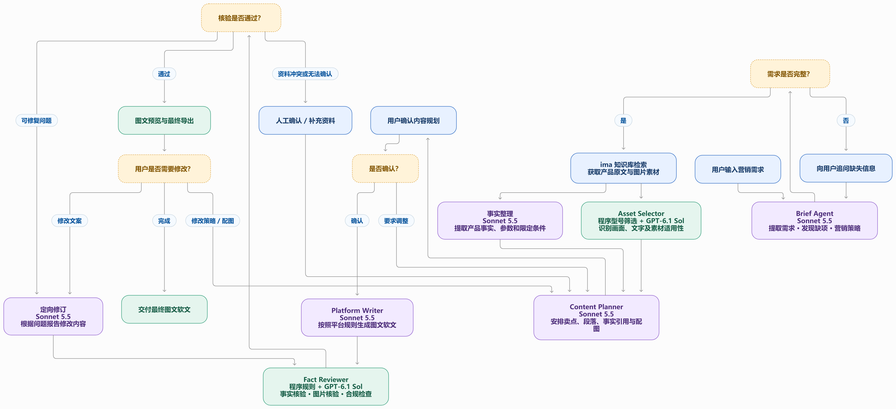

下面是根据你们当前 6 个核心模块 + 2 类模型 + 程序规则设计的完整工作流，包含 ima 知识库检索、用户确认、事实核验和失败后的定向修订闭环。

## 各模块输入输出

| 模块              | 模型               | 核心输出                           |
| --------------- | ---------------- | ------------------------------ |
| Brief Agent     | Sonnet 5.5       | Marketing Brief、营销策略、缺失信息、检索计划 |
| 事实整理            | Sonnet 5.5       | 事实卡、参数、限定条件、ima 原文引用           |
| Asset Selector  | 程序 + GPT-6.1 Sol | 图片卡、型号匹配结果、图片内容描述              |
| Content Planner | Sonnet 5.5       | 卖点顺序、段落大纲、事实与图片的映射             |
| Platform Writer | Sonnet 5.5       | 平台化图文稿、定向修订版本                  |
| Fact Reviewer   | 程序 + GPT-6.1 Sol | 事实核验、图片核验、合规问题、修订建议            |

### 三个关键设计建议

1\. Content Planner 是整个系统的核心协调环节。

它需要将 Brief Agent 的营销策略，与真实的产品事实和可用图片结合，形成一个有依据的图文规划，而不是直接让 Writer 从原始资料生成文章。

2\. Reviewer 不应直接修改文章。

Reviewer 只输出结构化问题报告，例如问题句子、错误类型、证据及修订要求。Writer 负责定向修改，修改之后再由 Reviewer 检查，避免同一个模型既生成又给自己放行。

3\. 加上最大修订次数。

建议自动修订最多 2 次。如果仍无法通过核验，或者涉及资料冲突，就停止自动循环并提示人工确认，防止模型无限反复调用。

这套架构的优势是：Sonnet 5.5 负责营销推理、策略规划与文案；GPT-6.1 Sol 负责视觉理解和独立核验；程序负责确定性筛选和约束。 各自的职责比较清楚，也便于后续独立评测与优化。
## 模块	核心输入	核心输出
Brief Agent	用户需求、已有上下文	MarketingBrief、策略、缺项、检索计划
事实整理	ima 原文、具体型号	FactCard[]
Asset Selector	ima 图片、目标型号、场景策略	AssetCard[]
Content Planner	Brief、FactCard、AssetCard	ContentPlan
Platform Writer	已确认的 ContentPlan、平台规则	ContentDraft
Fact Reviewer	文案、事实卡、图片卡、原文证据	ReviewReport